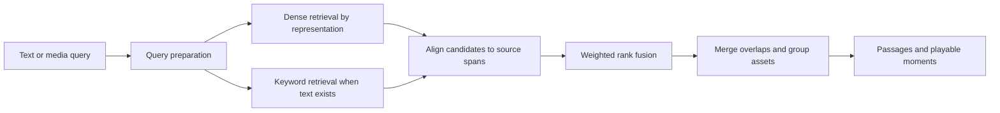

# Search Anything build plan

Status: backend phases 0–3 complete. Stopped before phase 4 (frontend) at the user's request.

Updated: 2026-10-09.

## Scope and decisions

Build a local application for searching uploaded text, documents, images, audio, and video. Support text queries and uploaded image/audio/video queries. Return matching passages, pages, regions when available, or playable time ranges with links to the original asset.

- Use `google/embeddinggemma-2` for embeddings across media types.
- Run embedding inference, Whisper, and Tesseract locally on this Mac.
- Use PostgreSQL with pgvector and native full-text search, plus RustFS for object storage.
- Include keyword search, transcription, OCR, separate media/transcript representations, configurable segmentation, weighted retrieval, and grouping in the first working release.
- Keep frontend implementation in a separate phase after backend ingestion and retrieval work.
- Include an opt-in combined media/text embedding experiment after separate representations work.
- Defer dataset selection, relevance evaluation, reranker selection, and advanced segmentation algorithms until a working application exists.
- Functional tests and integration checks belong in each implementation phase. They are separate from the deferred retrieval-quality evaluation dataset.

Initial deployment assumes a local, single-user application. Scope database records to a workspace from the start. Authentication and public hosting require a separate decision before exposing the application beyond the local machine.

## Existing code to draw from

Review and adapt bounded components rather than importing either application's full architecture.

| Reference                                                                                                       | Useful existing behavior                                                                                         | Adaptation needed                                                                                                            |
| --------------------------------------------------------------------------------------------------------------- | ---------------------------------------------------------------------------------------------------------------- | ---------------------------------------------------------------------------------------------------------------------------- |
| [Analyst embedding adapter](/Users/hari/Desktop/sandbox/agentic-rag-analyst/backend/app/retrieval/embedding.py) | Separate passage/query methods, search prompt, normalization, vector validation, model revision handling         | Support all media inputs, use a new 768-dimensional profile, validate current processor formats and mixed-media placeholders |
| [Analyst document ingestion](/Users/hari/Desktop/sandbox/agentic-rag-analyst/backend/app/sources/documents.py)  | Extracted blocks, structural grouping, tokenizer-aware windows, parent/child strategy, locations and generations | Generalize source locations to temporal media and add content-type dispatch                                                  |
| [Advanced RAG chunker](/Users/hari/Desktop/advanced-rag/backend/app/services/document/chunker.py)               | Markdown headings; protection of tables, OCR blocks, and fenced code; merging small chunks                       | Replace character-count bounds with embedding-token bounds; split oversized structural blocks explicitly                     |
| [Analyst extraction](/Users/hari/Desktop/sandbox/agentic-rag-analyst/backend/app/ingestion/extractors.py)       | Tesseract execution, language availability checks, rotation handling, PDF/image extraction                       | Preserve OCR boxes and confidence where supported; add timed video-frame extraction                                          |
| [Analyst retrieval](/Users/hari/Desktop/sandbox/agentic-rag-analyst/backend/app/retrieval/service.py)           | PostgreSQL lexical/dense retrieval, RRF, adjacent-overlap deduplication, source references                       | Add representation weights, temporal alignment, and grouping across representations                                          |
| [Analyst worker](/Users/hari/Desktop/sandbox/agentic-rag-analyst/backend/app/workers/main.py)                   | Persistent jobs, leases, heartbeat, cancellation, versioned processing                                           | Reduce to ingestion jobs and coordinate local model resources                                                                |

The inspected analyst adapter uses a configured dimension and has legacy model constraints. Do not copy those constraints into this application. The advanced-rag chunker preserves structure but currently counts characters. Neither implementation should define the new model's limits implicitly.

## Infrastructure and runtime

| Component                | Proposed choice                                                | Responsibility                                                                                  |
| ------------------------ | -------------------------------------------------------------- | ----------------------------------------------------------------------------------------------- |
| API                      | FastAPI, Pydantic                                              | Uploads, configuration, ingestion status, search, previews                                      |
| Database access          | SQLAlchemy, Alembic                                            | Typed persistence and schema migrations                                                         |
| Metadata and search      | PostgreSQL + pgvector + full-text search                       | Assets, jobs, generations, vectors, lexical indexing                                            |
| Object storage           | RustFS through an S3 client                                    | Original uploads, normalized audio, thumbnails, transcripts, OCR and other derived artifacts    |
| Background jobs          | PostgreSQL-backed queue with leases                            | Durable claims, retries, cancellation, heartbeat and progress                                   |
| Model execution          | Local inference process with bounded scheduling                | Reuse loaded models; prioritize queries; prevent simultaneous heavy jobs from exhausting memory |
| Media tools              | FFmpeg/ffprobe, Whisper, Tesseract                             | Decode/probe media, transcribe speech, extract written text                                     |
| Frontend, separate phase | React, TypeScript, Vite, pnpm, shadcn                          | Upload library, segmentation settings, search and source previews                               |
| Development              | uv, Black, standard logging; Docker Compose for infrastructure | Reproducible local services and commands                                                        |

Start with two infrastructure services, PostgreSQL and RustFS. A PostgreSQL queue avoids adding Redis solely for ingestion. Model execution remains replaceable if a remote GPU becomes useful later, but the initial system makes no remote inference calls.

Use an exact vector-search path for small corpora and correctness checks. Add cosine HNSW indexing as corpus size warrants it. Apply workspace and asset filters inside retrieval queries. Validate filtered approximate-search recall and use iterative scans or exact search for selective filters where necessary. [pgvector documentation](https://github.com/pgvector/pgvector#filtering)

Use a GIN index over `tsvector` fields and `websearch_to_tsquery` for user text. Weight titles and filenames separately from bodies. Record detected language and use an explicit text-search configuration, with a simple fallback. Native PostgreSQL full-text search is not BM25, and tokenized search does not guarantee exact identifier or substring matching. Add normalized identifier/filename lookups alongside it. [PostgreSQL text-search controls](https://www.postgresql.org/docs/current/textsearch-controls.html)

RustFS exposes S3-compatible storage. Verify the operations this application needs, especially upload, download, deletion, presigned access, and byte-range playback. Keep access behind an object-storage interface. [RustFS project](https://github.com/rustfs/rustfs)

## Data model and processing lifecycle

Use these conceptual entities:

- `workspaces`: local ownership and search scope.
- `assets`: original upload, content hash, MIME type, filename, storage key, duration/page count and lifecycle state.
- `ingestion_profiles`: content-specific segmentation, OCR/transcription and sampling configuration.
- `processing_generations`: immutable profile snapshot, extractor versions, model revisions and active-generation status.
- `segments`: logical searchable passages/pages/time ranges with hierarchy, offsets, neighboring segments and source locations.
- `representations`: text, transcript, OCR, image, audio, video, or combined media/text associated with a segment or source range.
- `embeddings`: representation ID, model/profile ID, revision, dimensions and normalized vector.
- `jobs`: stage, lease, heartbeat, attempts, progress, cancellation and structured failure details.
- `derived_artifacts`: storage keys, checksums, type and generation for reproducible extraction and cleanup.

Keep transcript-native boundaries and media-window boundaries, with timestamp-overlap mappings between them. Do not force an entire transcript into each media window. Store source coordinates before chunking so matching text can be traced back to the original extraction.

Processing stages are upload, probe, extraction, segmentation, embedding, indexing and activation. Jobs must be restartable and idempotent. Publish a new active generation atomically only when its required stages are complete. Keep the prior generation searchable while reprocessing.

Represent genuine absence separately from failure. A silent clip can have no transcript; an unavailable Whisper model is a failed transcription stage. Show failed or partial stages and allow retry. Deletion first excludes an asset from search, cancels work, and then removes all associated database records and storage artifacts through a retryable cleanup job.

## Content-specific ingestion

### Text and documents

Dispatch by parsed content type, not a universal fixed-size split.

| Content    | Segmentation behavior                                                           |
| ---------- | ------------------------------------------------------------------------------- |
| Plain text | Paragraph/sentence boundaries, then tokenizer-bounded windows                   |
| Markdown   | Heading hierarchy and blocks; preserve fenced code and tables when they fit     |
| HTML       | Main content and heading structure; omit boilerplate                            |
| PDF/DOCX   | Extracted pages, headings, paragraphs and tables; OCR scanned pages when needed |
| Code       | Language-aware function/class boundaries where supported, with bounded fallback |
| Tables     | Row groups with repeated column headers and table identity                      |

Preserve title/heading context, parent/child relationships and original offsets. Large tables or code blocks must still obey the model budget. Split with repeated context and record continuation metadata. Make target size and overlap configurable limits within a structural strategy.

### Images and OCR

Index the visual image and Tesseract text as separate representations. Preserve source geometry, OCR language, confidence and original versus normalized text. Correct rotation and preprocess images where useful. Prefer native document text when present; avoid indexing duplicate OCR of the same content.

For videos, run OCR on selected frames, retain timestamps, and collapse repeated unchanged screen text while preserving its visible time range. An explicit OCR failure should not silently become an empty successful result. [Tesseract quality guidance](https://tesseract-ocr.github.io/tessdoc/ImproveQuality.html)

### Audio and video

Use FFmpeg to probe streams and derive local working media. Transcribe audio files and video audio tracks with Whisper, retaining original language and timestamps. Keep speech transcription separate from native audio embeddings so non-speech sounds remain searchable. Choose the Whisper model during the local hardware check. Its internal transcription windows do not determine our retrieval segments. [Whisper implementation](https://github.com/openai/whisper#python-usage)

Start with configurable overlapping media windows. Record clip start/end, frame timestamps and sampling parameters. A video with sound gets visual, audio and transcript representations, plus OCR when text is present. A video without an audio stream skips audio/transcription explicitly.

Expose named presets for speech/lectures, general video, music/sounds and camera footage. Initially these presets select transparent window, overlap and sampling settings. Later scene detection, silence/VAD boundaries and other algorithms can replace fixed windows behind the same strategy interface.

## Embedding contract and context limits

Centralize embedding behavior in one adapter with explicit text-query, text-document, media and combined-input methods.

- Text search query: `task: search result | query: {query}` through `SearchQuery`, applied exactly once.
- Text corpus item: `title: {title} | text: {content}`; use `none` without a title.
- Pure image/audio/video inputs receive no text prefix.
- Combined inputs use documented media placeholders and matching media fields.
- Start at 768 dimensions with normalized vectors and pinned model/processor revisions.
- Use float32 as the compatibility baseline; test bfloat16 where supported. Avoid float16 inference.
- The shared input limit is 8,192 tokens. Defaults cost about 280 tokens/image, 140/frame and 25/second of audio. Video sampling defaults to 1 FPS; audio is mono 16 kHz.

These are model requirements and documented defaults. [EmbeddingGemma 2 model card](https://huggingface.co/google/embeddinggemma-2#best-practices)

Before encoding, validate the actual processed input length with space for titles, instructions and special tokens. Estimates can guide segmentation but are not the final check. Automatically subdivide oversized segments or reject invalid configurations clearly. Never silently truncate uploads or long media queries.

The earlier analyst implementation is a reference for separation of query/document formatting. The current model documentation is authoritative for media packaging. Validate mixed-media examples directly rather than assuming an image plus arbitrary text dictionary is sufficient.

## Retrieval and weighting

Search pipeline:

Index keyword-searchable content from the beginning, including transcripts, OCR, titles and filenames. Text queries use hybrid retrieval by default. Image-only queries can use visual retrieval without forcing OCR keywords; audio/video query preparation can supply transcript/OCR text when available. Offer semantic-only and keyword-only modes for inspection and explicit intent.

Keep vectors separate. Combine rankings rather than average transcript and media embeddings. Initial scoring uses weighted RRF over a common result unit:

`score(result) = sum(weight(channel) / (fusion_constant + rank(channel, result)))`

A channel is a retrieval list such as transcript dense, visual dense, audio dense or lexical. The fusion constant is separate from the candidate-count setting. Collapse repeated hits within a channel before fusion so a long transcript or many frames do not multiply that channel's contribution. Align transcript/OCR spans with media windows using source timestamps. Missing channels contribute nothing; do not fabricate scores.

Start with equal positive weights for enabled channels as an explicitly uncalibrated baseline. Allow per-profile adjustments and preserve each channel's contribution for inspection. A query clip that produces multiple windows must use bounded pooling rather than receive extra weight merely because it is long. Record this behavior in the search configuration.

Candidate count and displayed result count are separate. Retrieve extra candidates before grouping so duplicates do not leave a short results page. Expose optional dense similarity cutoffs by channel, but do not claim a universal relevance threshold or present similarity/RRF scores as probabilities. Threshold calibration belongs to the later evaluation phase.

For text, merge overlapping source-offset ranges within the same section and generation. For AV, merge overlapping matching time ranges while retaining distinct distant moments. Group by asset for display, preserving the best matching spans and per-representation evidence. Use the best grouped score initially rather than summing every chunk score.

### Combined media/text experiment

After separate representations work, add an opt-in combined representation for aligned media plus its transcript/OCR text. Preserve the separate representations. Compare separate-only, combined-only and both using the same sample queries, storage counts, ingestion time and query latency. Do not enable the combined channel in default fusion without checking whether duplicated evidence overweights particular assets. Formal quality evaluation follows in its own phase.

## Frontend behavior, implemented separately

The backend stores and validates all settings before frontend work begins.

- Upload library with asset type, processing stages, retry, cancel, delete and reprocess actions.
- Ingestion settings with automatic content-type selection and named presets.
- Advanced controls for text strategy, target token size/overlap, AV window/overlap, video sampling, OCR languages and transcription language/model where available.
- Show the effective settings and explain context-budget adjustments. Preview proposed segments before committing to expensive reprocessing where feasible.
- Distinguish ingestion settings that require reprocessing from retrieval weights that apply immediately.
- Search with text or uploaded media; file-type filters, optional keywords and representation weights.
- Grouped results with matching text, thumbnails, transcript/OCR evidence, and playback starting at the matching time range.
- Separate distant matches within one asset; expand to see additional matching passages/moments.

Default behavior should work without adjusting advanced controls. Do not expose unused settings or add controls that do not change processing or search.

## Implementation phases and acceptance criteria

| Phase                                    | Work                                                                                                                                                                   | Completion criteria                                                                                                                                                                      |
| ---------------------------------------- | ---------------------------------------------------------------------------------------------------------------------------------------------------------------------- | ---------------------------------------------------------------------------------------------------------------------------------------------------------------------------------------- |
| 0. Local model compatibility             | Pin dependencies/revisions; exercise EmbeddingGemma on each media type and combined input; test Whisper/Tesseract; select device, dtype and batch limits               | Finite normalized vectors; successful representative cross-media queries; measured memory/latency; documented CPU fallback; local models only                                            |
| 1. Infrastructure and backend foundation | Compose for PostgreSQL/RustFS; FastAPI/uv; migrations, storage adapter, durable jobs, generations, local inference scheduling                                          | Upload/download/delete and media byte ranges work; worker restart recovers jobs; API remains responsive during background inference                                                      |
| 2. Ingestion and indexing                | Structural text chunking; image/OCR; audio/video processing with Whisper; segmentation profiles; context checks; dense and lexical indexing                            | All four media types indexed through API/CLI; source locations retained; silence/missing streams handled; retries and reprocessing avoid duplicates; oversized inputs handled explicitly |
| 3. Backend search                        | Text/media query preparation; keyword and vector retrieval; weighted fusion; span alignment, overlap grouping, filters and source previews; opt-in combined experiment | API returns grouped passages/moments with channel evidence; weights change ranking without re-indexing; filters and deletion respected; source previews open at correct location         |
| 4. Frontend                              | Separate React/Vite application using completed backend APIs; library, settings, query uploads, grouped previews/playback                                              | Full upload-to-search workflow works in the UI; settings persist; processing failures/retries and context adjustments are visible                                                        |
| 5. Relevance evaluation                  | Decide datasets after using the working app; collect representative and no-match queries; measure per query/content pair                                               | Reproducible baseline for recall, ranking, no-match behavior and latency; compare weighting, segmentation and combined representations                                                   |
| 6. Reranking                             | Choose text and multimodal candidates using phase-5 evidence; implement optional bounded reranking                                                                     | Measured relevance gain fits local memory/latency budget; timeout/failure falls back to fused results; reranking can be disabled                                                         |
| 7. Better segmentation and scale         | Compare VAD/silence, scene changes and semantic boundaries; tune indexes/batching; consider smaller vectors                                                            | Improvements measured against the baseline; reprocessing uses versioned profiles and atomic generation replacement                                                                       |

Phases 0–4 produce the first complete application. Frontend is phase 4 only. Reranking and dataset selection do not block that release.

During backend phases, use CLI/API smoke workflows rather than building temporary frontend pages. Commit coherent implementation milestones using the user's conventional commit format when implementation begins.

## Verification during implementation

Use small local fixtures to check functional correctness, independent of the later relevance benchmark:

- Structure-aware splits preserve headings and provenance while bounding oversized tables/code.
- Prefixes apply once; dimensions and finite normalized vectors are checked.
- All processed inputs respect the shared context limit, including combined inputs.
- Transcript/OCR matches map to the correct page, region or timestamp.
- Rank fusion, channel weights and overlap grouping have deterministic examples.
- Keyword search covers extraction output and identifiers through their respective paths.
- Cancel/retry/restart/delete do not publish stale generations or resurrect deleted assets.
- Filtered approximate retrieval is compared with exact retrieval on integration fixtures.
- RustFS playback and cleanup work through the same storage interface used by the application.

## Decisions left for their owning phase

- Phase 0: exact Whisper model, supported inference device/dtype on this arm64 Mac, measured memory limits and pinned dependency versions. Installed RAM was not available through the current sandbox inspection.
- Phase 2: initial per-content presets and supported upload-format list, validated against representative files.
- Phase 5: evaluation dataset composition, channel calibration and relevance cutoffs.
- Phase 6: reranker models and whether the quality gain justifies multimodal inference cost locally.
- Future deployment: multi-user authentication, external access and remote GPU execution if requested.

## Implementation progress

- Phase 0 complete. On the M4 Pro, the pinned EmbeddingGemma checkpoint returned
  finite, normalized 768-dimensional vectors for text, image, audio, video,
  text/image, and combined inputs. CPU float32 is the verified fallback. Local
  Whisper tiny inference and Tesseract OCR ran against fixtures. Measurements
  and limitations are in `docs/local-models.md`.
- Phase 1 complete. PostgreSQL/RustFS composition, migrations, workspace-scoped
  uploads, downloads, byte ranges, presigned access, cleanup, durable fenced
  jobs, probing, and the single-owner inference scheduler are implemented and
  covered by unit and live integration checks. Details and run commands are in
  `docs/backend-foundation.md`.
- Phase 2 complete. Text, Markdown, HTML, PDF, DOCX, Python source, and image
  uploads now run through local structural extraction, OCR where needed,
  tokenizer-bounded segmentation, normalized EmbeddingGemma vectors, lexical
  indexing, and atomic generation activation. Local FFmpeg, Whisper tiny, and
  EmbeddingGemma now index audio/video windows, timed transcripts, sampled
  video frames, and OCR spans. Media presets, validated per-generation window
  and sampling overrides, missing-audio handling, source timestamps, frame
  limits, immutable profiles, retry/cancel/reprocess, and generation state
  preservation are covered by live and deterministic checks.
- Phase 3 complete. Hybrid text, image, audio, and video queries use the
  worker's single-owner inference scheduler over a private local IPC socket;
  the API does not load another model. PostgreSQL full-text/filename search
  and exact pgvector retrieval align source spans before weighted RRF and
  return one result per asset with separate matching passages/moments and
  channel evidence. Asset/type filters, request-time channel weights, dense
  cutoffs, and explicit separate/combined/both retrieval modes are implemented.
  Media query windows cover the full input up to 120 seconds for audio and 80
  seconds for video, with covered ranges returned and longer inputs rejected.
  Combined indexing is opt-in; processor context overflow skips only the
  combined representation and is recorded while base indexing continues. The
  comparison command reports retrieval latency, active vector counts and
  estimated vector payload bytes, plus indexing times grouped by combined
  profile. Live local acceptance covers image, audio, and video query paths and
  combined image/audio indexing.

## Planning sources

- [EmbeddingGemma 2](https://huggingface.co/google/embeddinggemma-2)
- [pgvector](https://github.com/pgvector/pgvector)
- [PostgreSQL full-text search](https://www.postgresql.org/docs/current/textsearch-controls.html)
- [RustFS](https://github.com/rustfs/rustfs)
- [Whisper](https://github.com/openai/whisper)
- [Tesseract](https://tesseract-ocr.github.io/tessdoc/ImproveQuality.html)
