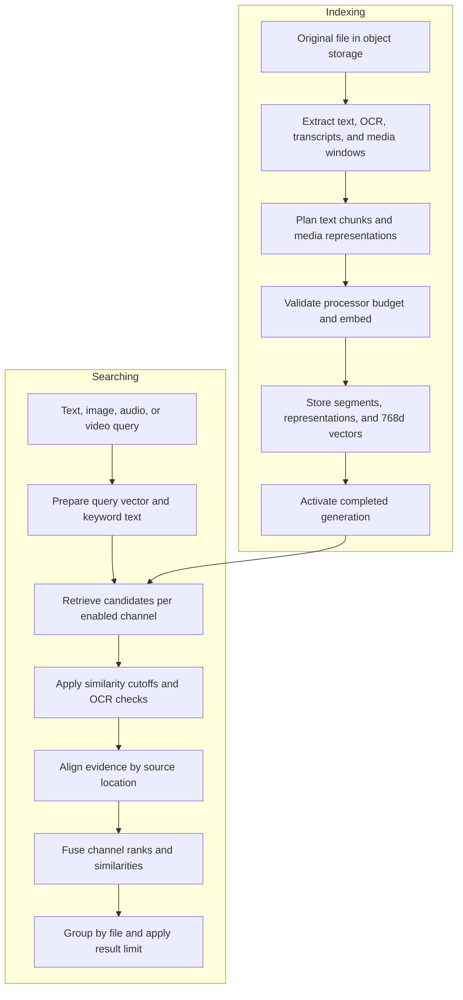
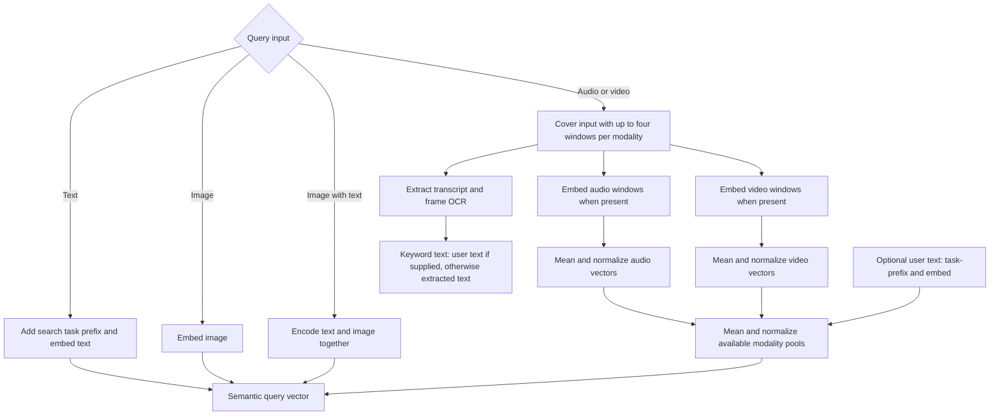
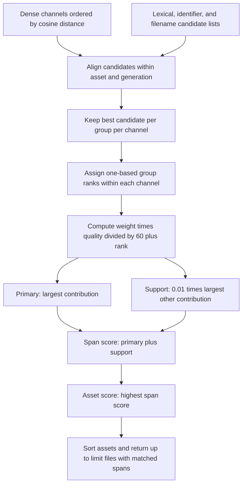

> Embedding inference now defaults to the standalone API. The worker uses the
> same pinned model revision, prompts, media windows, and 768-dimensional index.
> Token counts and offsets are computed locally without loading model weights.
> Set `SEARCH_EMBEDDING_BACKEND=local` to run the reference adapter in the worker.

# Embedding and search algorithm

This document describes the implementation as of 2026-10-11. Search Anything
uses a local multimodal embedding model, PostgreSQL keyword matching, and
source-aware rank fusion. A file can have several searchable representations,
such as an image and its OCR text, or a video window and its transcript.
Search ranks matching source spans first, then returns one result per file.

## End-to-end flow



## 1. Embedding model and input formats

The worker's [HTTP adapter](../src/search_anything/embedding_client.py) sends
prepared inputs to the EmbeddingGemma API. The service loads
`google/embeddinggemma-2` at the pinned revision
`914f7f89142e33e77833254d9c9b90c3cef7303b`, with float32 weights. The managed
service uses offline model loading and defaults to Apple MPS when available,
with CPU as the fallback. The original adapter in
[`embeddings.py`](../src/search_anything/embeddings.py) remains available for
explicit local mode and parity checks.

Text-only batches use JSON. Media batches send one multipart request containing
prepared PNG images, WAV audio windows, and ordered video frame images alongside
a JSON `payload` field. Media parts reference named file fields, and
`video_frames.files` preserves the worker's frame order. The worker does not call
`/v1/uploads`; a job retry resends the prepared bytes without depending on upload
IDs or their expiration. The API removes request-local files after inference.

Every embedding has 768 dimensions. Encoding requests L2 normalization, then
checks the output shape, finite values, and a norm between 0.98 and 1.02.
The default batch size is 8. Text and media share the model's embedding space,
which lets a text query retrieve an image, audio window, or video window.

Text queries use this explicit task prefix:

```text
task: search result | query: <trimmed query>
```

Indexed text uses this document format:

```text
title: <filename or none> | text: <heading, if present>
<chunk text>
```

The title helper collapses title whitespace and substitutes `none` when no
title is available. The worker supplies the filename as the title for ordinary
text chunks. The stored searchable body remains the chunk text, while the
heading is also stored as metadata for keyword ranking.

Images pass directly to the model. Audio uses the `<|audio|>` marker and a
local PCM WAV path. Video uses `<|video|>` and a sequence of decoded frames.
Combined inputs put non-empty aligned text and media into one model input,
with the matching `<|image|>`, `<|audio|>`, and `<|video|>` markers. A combined
embedding is a model encoding of the mixed input, rather than an average of
separately computed vectors.

Before encoding, the adapter runs the actual processor with text truncation
disabled. Inputs exceeding the configured context budget fail explicitly.
The default and maximum budget is 8,192 processed tokens. Audio inputs also
have a separate 30-second limit to prevent processor truncation.

## 2. Building searchable representations

[`ingestion.py`](../src/search_anything/ingestion.py) extracts structural
blocks and plans text chunks. [`worker.py`](../src/search_anything/worker.py)
embeds those chunks and media inputs, then persists the results.

| Representation kind | Input                                                          |
| ------------------- | -------------------------------------------------------------- |
| `text`              | Extracted document text, including code and tables             |
| `ocr`               | Tesseract text from images, scanned PDF pages, or video frames |
| `transcript`        | Local Whisper speech transcription                             |
| `image`             | A decoded still image                                          |
| `audio`             | A bounded mono 16 kHz audio window                             |
| `video`             | Sampled frames from a bounded video window                     |
| `combined`          | Aligned text and media encoded together, when enabled          |

### Text chunking

The default target is 700 tokens with an 80-token overlap. These are ingestion
profile options, recorded in each processing generation. The budget includes
the title, heading, formatting, and processor special tokens.

1. Keep each structural block intact if its formatted input fits the target.
   Small blocks stay separate; the chunker does not pack them together.
2. For oversized tables, first try splitting between rows and repeating the
   column headers in each continuation chunk.
3. Otherwise, obtain tokenizer character offsets and binary-search for the
   longest slice that fits the budget.
4. For prose blocks, prefer a sentence or newline boundary in the final 30%
   of that slice. For code and table blocks, prefer a newline in its final 50%.
   Fall back to the token boundary if no preferred boundary exists.
5. Advance to the chosen end minus the overlap, while guaranteeing at least
   one token of forward progress.

Chunks retain page, heading, table, source character offsets, and timestamps
where available. If a timed text block needs splitting, the chunker estimates
its subchunk timestamps in proportion to character positions within the block.
Required heading context that cannot fit raises a context error.

### Audio and video windows

FFprobe identifies streams and duration. FFmpeg decodes audio and samples
video frames. Whisper tiny produces timed transcript text, and Tesseract
extracts text from sampled frames. Adjacent repeated frame OCR can merge into
one timed text block.

| Ingestion preset  | Window seconds | Overlap seconds | Requested video frames/second |
| ----------------- | -------------: | --------------: | ----------------------------: |
| `speech_lectures` |             30 |               5 |                           0.5 |
| `general_video`   |             20 |               5 |                             1 |
| `music_sounds`    |             15 |               3 |                           0.5 |
| `camera_footage`  |             10 |               3 |                             1 |

Automatic selection uses `speech_lectures` for audio and `general_video` for
video. Profiles can override these values. Audio windows longer than 30 seconds
are split further. Video decoding caps each window at 32 frames by lowering
the effective sampling rate when necessary. Actual frame timestamps remain
in metadata.

`combined_media_text` defaults to `false`. When enabled, indexing also creates
combined representations for image plus OCR, audio plus transcript, or aligned
video/audio plus transcript/OCR. A combined input that exceeds the processor
budget is skipped and its context failure is recorded. Separate representations
remain available.

### Storage and generation visibility

PostgreSQL stores source locations in `segments`, searchable text and modality
kinds in `representations`, and model metadata plus `vector(768)` values in
`embeddings`. Original files remain in object storage.

Search joins only ready assets to their active processing generation and
requires that generation to be active. A reprocessing job builds a new
generation before replacing the active one, so partial new representations
do not enter search results. Queries also filter by workspace, optional exact
content types, and optional asset IDs.

## 3. Preparing queries

The semantic paths below run for semantic and hybrid search. Keyword mode
uses query text and skips embedding.



| Query input     | Semantic query vector                                    | Keyword query text                                        |
| --------------- | -------------------------------------------------------- | --------------------------------------------------------- |
| Text            | Task-prefixed text embedding                             | User text                                                 |
| Image           | Image embedding                                          | User text, if supplied                                    |
| Image with text | One combined image/text embedding                        | User text                                                 |
| Audio or video  | Normalized pools of media vectors and optional user text | User text if supplied; otherwise extracted transcript/OCR |

Media queries cover the input with at most four windows per modality. Audio
uses 30-second windows and video uses 20-second windows. Window starts are
spread between zero and the latest full-window start to cover the duration.
Inputs longer than 120 seconds of audio or 80 seconds of video fail rather
than silently dropping the remainder. A video with audio must satisfy both
applicable limits. Query video sampling requests one frame per second.

For each modality, the worker averages its window embeddings and normalizes
the mean. It then averages and normalizes the available modality pools,
including a task-prefixed user-text embedding when supplied. This gives each
available modality equal weight in the final pool, regardless of its window
count. Extracted transcript/OCR supplies keyword text; it is not separately
embedded into this semantic query pool. An invalid or near-zero pooled vector
fails explicitly.

Keyword mode skips query embedding. Media queries still run transcription and
OCR to obtain keyword text. Pure image queries do not run query-side OCR.

## 4. Candidate retrieval

[`retrieval.py`](../src/search_anything/retrieval.py) retrieves ordered lists
independently for each enabled channel.

| Search mode | Channels                                |
| ----------- | --------------------------------------- |
| `semantic`  | Dense embedding channels                |
| `keyword`   | `lexical`, `identifier`, and `filename` |
| `hybrid`    | Dense embedding and keyword channels    |

The `representation_mode` option selects the dense kinds:

- `separate`, the default, searches `text`, `transcript`, `ocr`, `image`,
  `audio`, and `video`.
- `combined` searches only `combined` and disables all keyword retrieval.
- `both` searches all seven dense kinds and permits keyword retrieval.

Consequently, `keyword` with `representation_mode=combined` returns no
candidates. Combined search also needs assets indexed with combined
representations; ordinary text-only assets do not get them.

### Semantic channels

Each kind gets an exact pgvector cosine-distance query, ordered by increasing
distance. The current schema has no HNSW or IVFFlat index. Stored embeddings
must match the model ID, pinned revision, and dimension count.

```text
cosine_similarity(q, x) = dot(q, x) / (norm(q) * norm(x))
similarity = 1 - cosine_distance(q, x)
```

Each channel retains up to `candidate_limit` representations. The default is
60, with a permitted range of 10 to 200. OCR fetches up to three times that
number before filtering, then keeps at most `candidate_limit`. Optional
per-kind similarity cutoffs discard candidates below their threshold. No
semantic cutoff applies by default.

### Keyword channels

`lexical` uses PostgreSQL `websearch_to_tsquery('simple', query)`. It matches
either the representation body/heading or filename. Its ordering score is:

```text
lexical_rank = ts_rank_cd(weighted_body_and_heading, query)
             + 2 * ts_rank_cd(filename_vector, query)
```

Headings have full-text weight `A`; body text has weight `B`. The `simple`
configuration does not apply language-specific stemming. GIN indexes cover
the weighted body/heading expression and the filename text vector.

`identifier` finds an escaped literal substring in lowercased representation
text. `filename` does the same against lowercased filenames and selects one
representative row per asset. Both normalize the query by collapsing whitespace
and applying Unicode case folding. Stored text whitespace is not collapsed.
These are literal substring matches, without fuzzy or edit-distance matching.

Identifier candidates order by filename, asset ID, segment ordinal, and
representation ID. Filename candidates order by asset ID. These channels
therefore use deterministic ordering rather than a graded relevance score.
The lexical `ts_rank_cd` value determines candidate order but does not enter
the final fusion formula directly.

### OCR quality checks

Except for the filename channel, OCR evidence must contain at least one
alphanumeric token of two or more characters. If OCR confidence metadata
exists, at least half the alphanumeric character count must come from entries
with finite confidence of 60 or higher. Older OCR without confidence metadata
passes the confidence check. This retains short labels such as `A1` or `42`
while rejecting single-character fragments and mostly low-confidence text.

## 5. Aligning evidence and fusing ranks

Fusion first groups candidates that refer to the same representation or
overlapping source location within the same asset and processing generation.
This lets an image and its OCR, or a video and its transcript, support one
matched span.

- Timed evidence must strictly overlap. A group retains a common time
  intersection, preventing a chain of overlaps from merging disjoint moments.
- Source-offset evidence must share its structural scope, including table,
  section, and heading metadata. Source ranges that touch can align.
- Page evidence must share the page. Ranged text also respects structural
  scope; whole-page OCR can align with other evidence on that page.
- A still image and its OCR align at the asset level when image dimensions
  identify the OCR as belonging to a static image.

Within each channel, multiple candidates for the same aligned group count
once. The best-ranked candidate represents that group. Group ranks are
one-based after this deduplication.

Although the function is named `reciprocal_rank_fusion`, its score is a
modified reciprocal-rank formula. For channel `c` and aligned group `g`:



```text
quality(c, g) = clamp(cosine_similarity, 0, 1)^2   for dense evidence
quality(c, g) = 1                               for keyword evidence

contribution(c, g) = weight(c) * quality(c, g) / (60 + rank(c, g))

primary = channel with the largest contribution
support_bonus = 0.01 * largest non-primary contribution, or 0 if absent
score(g) = contribution(primary, g) + support_bonus
```

All channel weights default to `1.0`. Request overrides may range from 0 to
10; zero disables a channel. Negative semantic similarity contributes zero.
The cosine factor is a quality heuristic, not a relevance probability.

The strongest evidence determines nearly all of the score. Supporting
channels share the small bonus in proportion to their original contributions.
Their total bonus depends on the strongest supporting channel, so accumulating
more channels does not inflate it by simple addition.

For example, a rank-1 image match with cosine similarity `0.8` and weight `1`
contributes `0.8^2 / 61`, about `0.01049`. A rank-1 keyword match contributes
`1 / 61`, about `0.01639`. If these align, keyword evidence is primary and
the image adds about `0.000105`, giving a final score of about `0.01650`.
Raw keyword ranks and cosine values are never directly added together.

## 6. Grouping results by file

After fusion, `group_assets` gathers matched spans into one outer result per
asset. The asset score is its highest span score. Additional matching spans
remain in `matches` and do not increase the asset score.

Each match includes its score, channel contributions, representation IDs,
kinds, text, location metadata, cosine similarities, and channel evidence.
Aligned timed matches report the intersection of member time ranges. Source
offsets report the enclosing minimum start and maximum end. Individual
representation ranges remain available in the response.

Assets sort by descending score, then filename. The final `limit`, default
10 and maximum 50, applies after asset grouping. `candidate_limit` must be
at least `limit`, but it applies per channel before grouping. Many candidate
representations from one file can therefore leave fewer than `limit` files.

## 7. Execution and configuration

The API queues durable search jobs in PostgreSQL. The worker owns model
inference and retrieval. Search endpoints wait up to five seconds by default,
returning completed results with HTTP 200 or a job ID with HTTP 202. Clients
can poll `/api/search/jobs/{id}`. `SEARCH_QUERY_WAIT_SECONDS` controls the wait.

Text requests use `/api/search`; images use `/api/search/image`; audio and
video use `/api/search/media`. Image and media requests accept optional text.
They default to hybrid when text is supplied and semantic otherwise. Text
search defaults to hybrid.

Example text-search body:

```json
{
  "query": "invoice INV-2026-1042",
  "mode": "hybrid",
  "representation_mode": "separate",
  "limit": 10,
  "candidate_limit": 60,
  "weights": {"identifier": 2.0, "ocr": 0.5},
  "similarity_cutoffs": {"text": 0.4, "image": 0.5}
}
```

These weights and cutoffs illustrate the request format; they are not measured
optimal settings. Increasing candidate limits broadens the pool available to
fusion but increases retrieval and alignment work. Exact vector retrieval
also becomes more expensive as the searchable collection grows. There is no
separate cross-encoder reranker or learned final ranking model in this path.

## Implementation references

- [`embeddings.py`](../src/search_anything/embeddings.py): model loading,
  formatting, processor validation, and normalized encoding.
- [`ingestion.py`](../src/search_anything/ingestion.py) and
  [`media.py`](../src/search_anything/media.py): extraction, chunk planning,
  media presets, decoding, OCR, and transcription.
- [`worker.py`](../src/search_anything/worker.py): representation indexing,
  query preparation, pooling, and job execution.
- [`retrieval.py`](../src/search_anything/retrieval.py): candidate queries,
  OCR filtering, alignment, fusion, and asset grouping.
- [`search_requests.py`](../src/search_anything/search_requests.py) and
  [`settings.py`](../src/search_anything/settings.py): request validation
  and runtime defaults.
- [Ingestion and indexing](ingestion.md), [local models](local-models.md),
  [search benchmarks](search-benchmark.md), and
  [retrieval fixes](retrieval-fixes-2026-10-11.md): related operational and
  evaluation notes.
